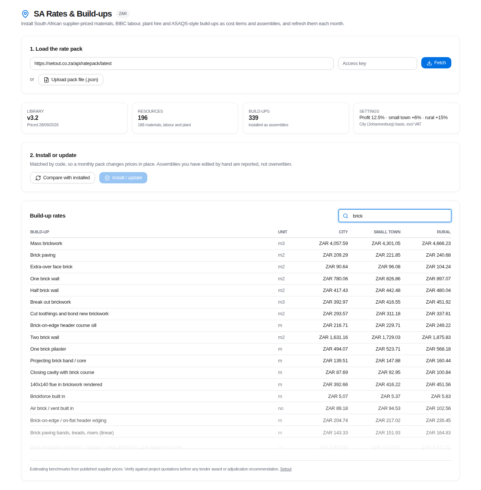
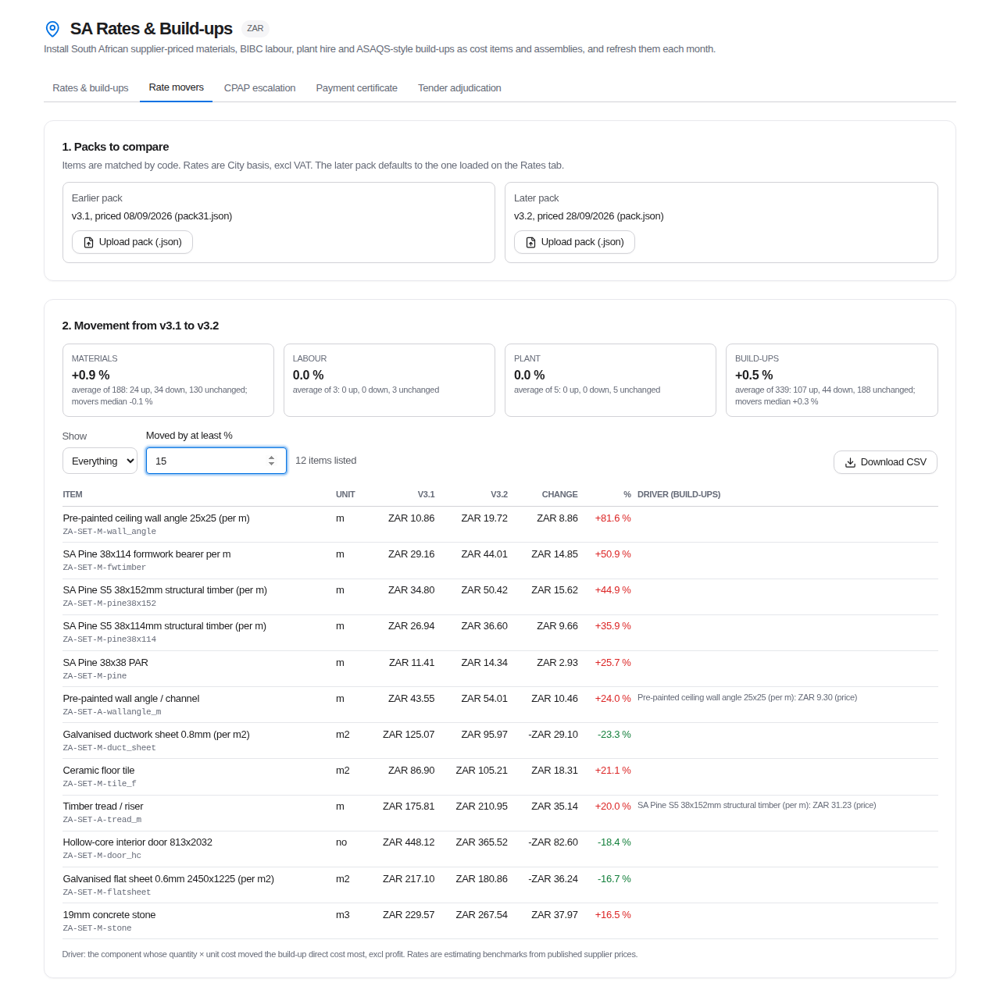
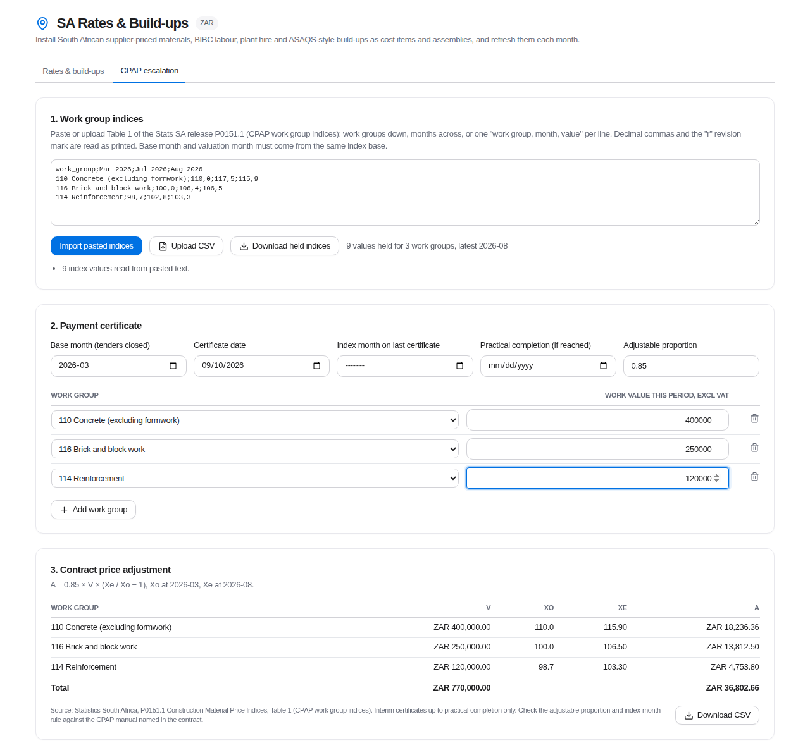
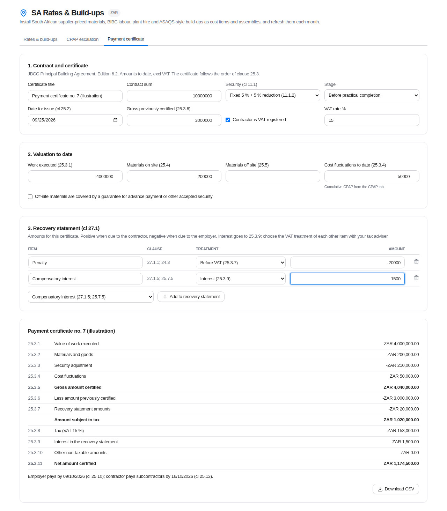
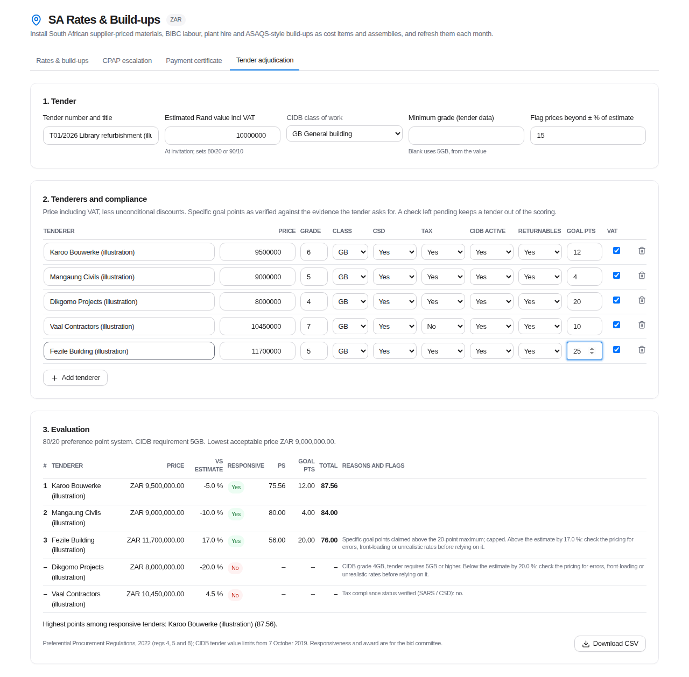
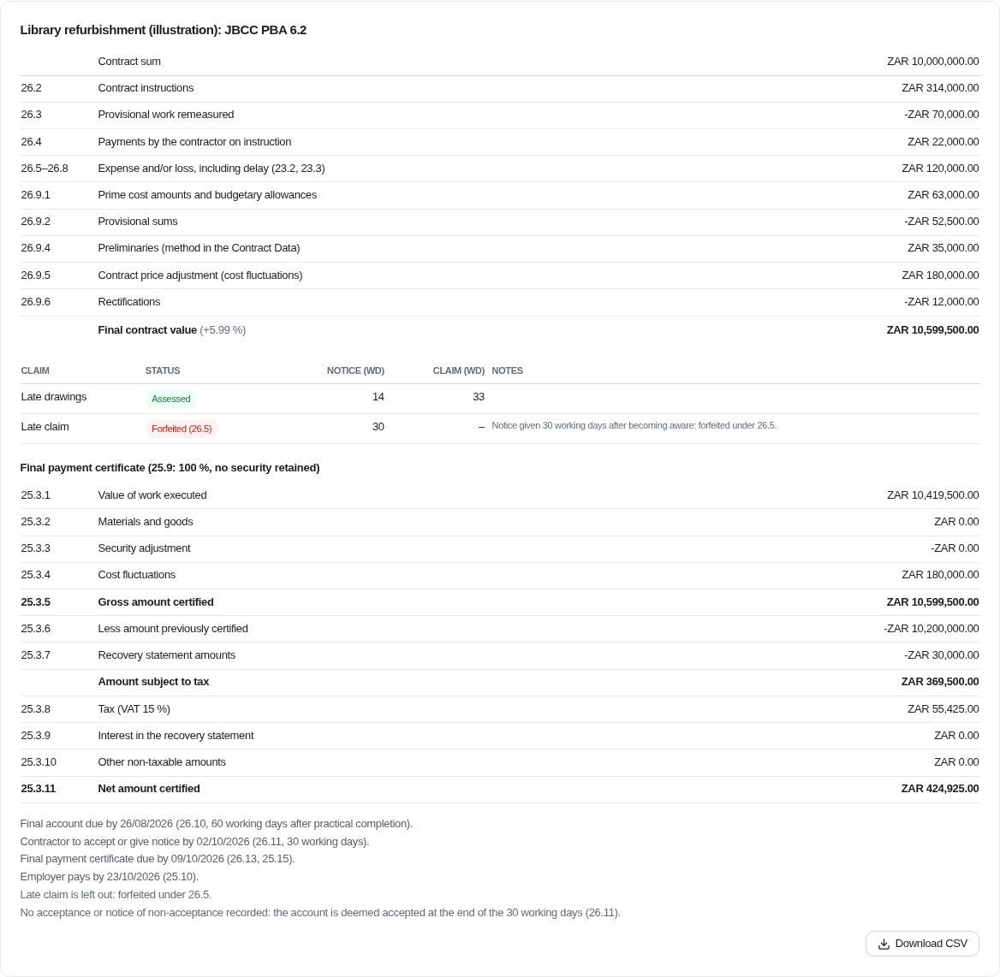
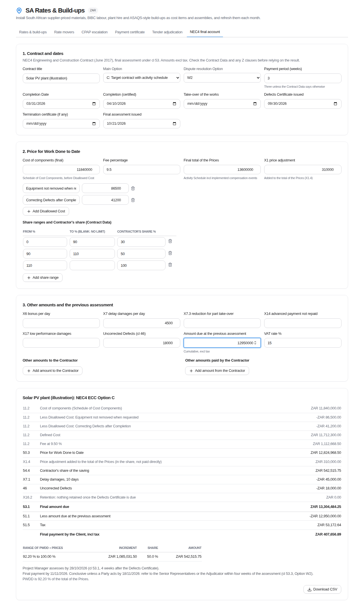

# SA Rates & Build-ups for OpenConstructionERP

A module for [OpenConstructionERP](https://github.com/datadrivenconstruction/OpenConstructionERP) that installs a South African rate library into the app's own Costs and Assemblies. The library covers supplier-priced materials, BIBC-based labour, plant hire and ASAQS-style rate build-ups. A new pack each month updates the rates in place.

This is an independent module by [Setout](https://setout.co.za). It is not part of OpenConstructionERP and is not endorsed by DataDrivenConstruction. The upstream project does not accept external pull requests, so the module is published here for anyone to install on their own instance.



## What it does

| In the rate pack | Becomes in OpenConstructionERP |
|---|---|
| Materials, labour, plant | Cost items in ZAR, region `ZA`, source `setout`. The rate is the City (Johannesburg) average excl VAT, and the supplier low–high range goes in the description. |
| Build-ups | Assemblies tagged `setout-za`. Component costs exclude profit; profit is the bid factor. Small-town and rural uplifts are regional factors (`ZA_CITY`, `ZA_SMALL_TOWN`, `ZA_RURAL`) that you pick when applying an assembly to a BOQ. |

- **Validation:** before installing, every build-up is checked. Its components plus profit must reproduce the published rate to the cent. If any check fails, nothing is installed.
- **Monthly updates:** codes are stable (`ZA-SET-M-…`, `ZA-SET-L-…`, `ZA-SET-P-…`, `ZA-SET-A-…`), so a monthly pack changes prices in place and only what moved gets updated.
- **Hand-edited assemblies:** if an assembly's recipe no longer matches the pack, it is listed and left alone.
- **No backend changes:** it uses only existing endpoints.

## Rate movers (from v0.5.0)

A tab that compares two rate packs, usually last month's and this month's, item by item:

- **Changes:** both rates, the change in rand and the percentage, largest first. New, dropped and re-united items are flagged rather than given a percentage.
- **Build-up drivers:** for each build-up that moved, the component that moved its direct cost most, and whether it was a price or a quantity change. A change in the profit setting is reported separately.
- **Summary per kind:** the average change, the count up, down and unchanged, and the median of the movers.
- **Filters and export:** filter by kind and by minimum percentage, and download the full list as CSV for a monthly rate sheet.



*The screenshot compares the v3.1 (08/09/2026) and v3.2 (28/09/2026) packs, filtered to moves of 15 % or more.*

## CPAP escalation (from v0.2.0)

A tab works out the JBCC contract price adjustment for an interim payment certificate, using `A = 0.85 × V × (Xe / Xo − 1)` for each work group.

- **Indices:** the CPAP work group indices from Stats SA release P0151.1, Table 1, which are free to use with Stats SA acknowledged. You can paste the table from the release or upload it as CSV.
- **Index month:** the index month is picked by the 15th-of-the-month rule, and the months since the last certificate are averaged.
- **Practical completion:** it stops at practical completion rather than guessing at the late-certificate method.
- **Output:** a CSV for the recovery statement.

Details and sources are in [module/sa-rates/README.md](module/sa-rates/README.md).



*In the screenshot, the July and August 2026 values are as published. The March 2026 base-month values are made up for illustration.*

## Payment certificate (from v0.3.0)

A tab produces a JBCC PBA 6.2 interim payment certificate in the order of clause 25.3:

- **Security adjustment:** worked out for whichever security the contractor chose (cl 11.1.1, 11.1.2 with the 95 % / 97.5 % / 100 % steps of cl 25.12, or 11.4.1).
- **Off-site materials:** included only when they are covered by a guarantee (cl 25.5).
- **CPAP:** cost fluctuations previously certified, plus this certificate's adjustment, which can be taken from the CPAP tab with one click (from v0.4.0).
- **Recovery statement items** (cl 27.1): each one is placed before or after VAT as you choose.
- **Payment dates:** 14 days after the date for issue for the employer (cl 25.10), and a further 7 for subcontractors (cl 25.13).

Exports to CSV. Details are in [module/sa-rates/README.md](module/sa-rates/README.md).



## Tender adjudication (from v0.4.0)

A tab scores a public construction tender under the Preferential Procurement Regulations, 2022:

- **System:** 80/20 at or below an estimated R50 million including VAT, 90/10 above it (regs 4 and 5).
- **Price points:** worked out against the lowest *responsive* price. A price more than double that scores negative points, which are flagged rather than clipped.
- **Specific goal points:** capped at 20 or 10. Ties are broken on goal points, and then left to the drawing of lots (reg 8).
- **CIDB grade:** read off the tender value limits in force from 7 October 2019, unless the tender data sets its own minimum.
- **Responsiveness:** CSD, tax compliance, active CIDB registration and returnables must all be "yes". A pending check keeps the tender out of the scoring.
- **Price flags:** prices outside a set band around the estimate are flagged for a pricing review.

The tab does the arithmetic. Responsiveness and award stay with the bid committees. Exports to CSV. Details are in [module/sa-rates/README.md](module/sa-rates/README.md).



*The tenderers in the screenshot are made up.*

## JBCC final account (from v0.7.0)

A tab for the final account and final payment certificate under the JBCC Principal Building Agreement, Edition 6.2 (June 2024):

- **Final contract value:** the contract sum adjusted under clause 26. That covers contract instructions by pricing basis (26.2.3 at cost plus 10 %), provisional work as executed, payments by the contractor plus 10 %, assessed expense and loss claims, PC amounts and provisional sums with prorated profit and attendance, preliminaries, cost fluctuations and rectifications.
- **Claim checks:** notice, claim and assessment periods are counted in working days. Late notice forfeits the claim (26.5), and an unassessed claim is deemed refused (26.8).
- **Final payment certificate:** 100 % of the final account plus the recovery statement, with no security retained (25.9).
- **Dates:**
  - final account due 60 working days after practical completion;
  - 30 working days to accept, or the account is deemed accepted;
  - 10 working days before a disagreement can be declared;
  - final payment certificate 7 calendar days after acceptance, but not before final completion.
- **Working days:** these exclude weekends, South African public holidays (Easter and the Sunday rule are worked out) and the contractor's annual holiday.

Details are in [module/sa-rates/README.md](module/sa-rates/README.md).



*The contract in the screenshot is made up.*

## NEC4 final account (from v0.6.0)

A tab for the final assessment under the NEC4 Engineering and Construction Contract (June 2017), Options A to E:

- **Price for Work Done to Date by Option:** Prices for completed work (A, B), or Defined Cost after Disallowed Cost plus the Fee (C, D, E).
- **Contractor's share** (Options C and D, cl 54): the saving or excess worked increment by increment across the share ranges from the Contract Data. Under D it is measured against the Total of the Prices.
- **Secondary options:**
  - X1 price adjustment, paid under A and B and added to the target under C and D;
  - the X6 bonus and X7 delay damages, worked out from the dates;
  - the unrepaid X14 advanced payment, X17 low performance damages and cl 46 uncorrected Defects;
  - X16 retention, which is released.
- **Payment and dates:** the final payment as the change from the last amount due, plus tax. The cl 53 dates cover when the assessment is due, when payment is due, and the W1, W2 or W3 window after which the assessment becomes conclusive.

Details are in [module/sa-rates/README.md](module/sa-rates/README.md).



*The contract in the screenshot is made up.*

## Install

Tested against OpenConstructionERP **18.8.0** (`321e514`). Current release: v0.7.0.

```bash
git clone https://github.com/aidankoetaan-tech/openconstructionerp-sa-rates.git
python openconstructionerp-sa-rates/install.py /path/to/OpenConstructionERP --check   # see what it will touch
python openconstructionerp-sa-rates/install.py /path/to/OpenConstructionERP
cd /path/to/OpenConstructionERP/frontend
npx vitest run src/modules/sa-rates
npm run build
```

The installer does three things and nothing else:

1. Copies `module/sa-rates/` into `frontend/src/modules/`.
2. Adds the manifest to `_registry.ts`.
3. Adds the menu label to each locale file.

It edits by anchor rather than by diff, so it survives unrelated upstream changes. Running it a second time changes nothing.

Then enable **SA Rates & Build-ups** on the Modules page. It appears under **Cost Data** in the sidebar once Advanced mode is on.

## Getting a rate pack

The prices aren't in this repository. They come as a monthly JSON rate pack (`setout.za.ratepack/1`) published by Setout. The hosted download isn't live yet, so in the meantime ask for the current pack at **hello@setout.co.za**.

You can load a pack in two ways:

- **Upload the `.json` file.** This always works.
- **Fetch it from a URL with an access key.** The browser only allows this if your deployment's CSP `connect-src` includes the pack host. Stock OpenConstructionERP doesn't allow it (`backend/app/middleware/security_headers.py`), so on a default install, use the upload.

The pack format is defined and validated in [`module/sa-rates/data/ratepack.ts`](module/sa-rates/data/ratepack.ts). The unit tests use a two-build-up sample cut from the v3.2 pack (`data/fixturePack.ts`).

## Checks run before each release

- **Tests:** vitest for the module, the module registry, manifest i18n, sidebar and Modules-page suites.
- **Types:** strict TypeScript over the module and its imports.
- **Lint:** ESLint on the module.
- **Rendered:** the page was rendered with a real pack loaded (see the preview above).
- **Not yet tested against a live OpenConstructionERP backend.** The endpoint contracts were read from the 18.8.0 backend source.

## Rates disclaimer

These rates are estimating benchmarks taken from published supplier prices. Verify them against project quotations before any tender award or adjudication recommendation.

## Licence

AGPL-3.0-only, the same as OpenConstructionERP, which this module extends (see [LICENSE](LICENSE)). The licence covers the code. Rate packs are licensed separately by Setout.

Copyright (c) 2026 Aidan Koetaan / Setout.
